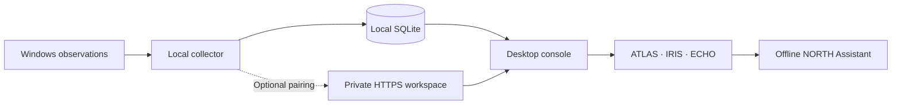

# NORTH

**Network Operations, Reconnaissance, Threat Hunting**

NORTH is a Windows-first investigation console. **ATLAS** shows devices and observed connections, **IRIS** searches evidence, and **ECHO** reconstructs investigations. Start in Simple mode for a plain-language overview, or switch to Analyst mode for rules, source coverage, and evidence details. NORTH Assistant answers from data already loaded in the app and works offline.

<!-- Preview media slot. Add a screenshot or short GIF from a synthetic workspace here before publication. -->

## Quick start

1. Open the successful **Build NORTH for Windows** workflow run for the commit you want to try. Download its **NORTH-Windows-x64** artifact and extract it. [Windows build workflow](https://github.com/aahmedhaitham/N.O.R.T.H/actions/workflows/desktop.yml)
2. Verify the SHA-256 checksum before running **NORTH-Setup-Windows-x64.exe**. Downloads from this workflow are unsigned previews. [Preview release notes and verification](docs/RELEASE-PREVIEW.md)
3. Open NORTH, finish or skip setup, and use **Ctrl+J** for NORTH Assistant. In **This computer**, NORTH uses local data and can offer monitoring when the account has access to Windows sources.

To run the synthetic developer demo, see [Development](docs/DEVELOPMENT.md). Source builds and the optional hosted deployment have separate setup instructions.

## How it works

[Architecture](docs/ARCHITECTURE.md) · [Assistant intent guide](docs/ASSISTANT.md) · [Cloud setup](docs/CLOUD.md) · [Lab and Wazuh](docs/LAB.md)

## Coverage and limits

| Evidence | Status |
|---|---|
| Bundled detection rules | Synthetic positive and negative fixtures |
| Live detection coverage | [Not yet measured](docs/COVERAGE.md) |
| Performance | [Reproducible synthetic benchmarks](docs/PERFORMANCE.md) |

Nearby devices come from observations available to the current collector or configured router. Source access and collector coverage affect what NORTH can show. A finding is a triage signal. Country attribution is approximate, and bytes per device require a source that measures them. The Windows preview is unsigned.

[Privacy](PRIVACY.md) · [Security](SECURITY.md) · [Threat model](THREAT_MODEL.md) · [Third-party notices](THIRD_PARTY_NOTICES.md) · [Progress](PROGRESS.md)
