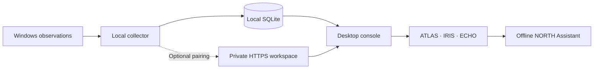

# NORTH

**Network Operations, Reconnaissance, Threat Hunting**

NORTH is a Windows-first investigation console. **ATLAS** shows devices and observed connections, **IRIS** searches evidence, and **ECHO** reconstructs investigations. Start in Simple mode for a plain-language overview, or switch to Analyst mode for rules, source coverage, and evidence details. NORTH Assistant answers from data already loaded in the app and works offline.

<!-- Preview media slot for a screenshot or short GIF from a synthetic workspace. -->

## Quick start

1. Download the Windows installer and SHA256SUMS.txt from the [public NORTH v0.3.0 preview](https://github.com/aahmedhaitham/NORTH-Releases/releases/tag/v0.3.0-preview).
2. Verify the SHA-256 checksum before running **NORTH-Setup-Windows-x64.exe**. This Windows preview is unsigned. [Preview release notes and verification](docs/RELEASE-PREVIEW.md)
3. Open NORTH, finish or skip setup, and use **Ctrl+J** for NORTH Assistant. In **This computer**, NORTH uses local data and can offer monitoring when the account has access to Windows sources.

To run the synthetic developer demo, see [Development](docs/DEVELOPMENT.md). Source builds and the optional hosted deployment have separate setup instructions.

## What you can do with NORTH

| Workspace | What you can do |
| --- | --- |
| **ATLAS · Network inventory** | Inspect nearby devices, adapter traffic, and observed connections. Review DNS and gateway diagnostics or open a PCAP/PCAPNG trace. |
| **IRIS · Event explorer** | Search recorded events, filter by host or event type, and open the underlying evidence. |
| **ECHO · Investigations** | Replay an incident timeline, inspect process relationships, and export an evidence-linked report. |
| **Detections** | Review local findings and enabled rules, then inspect which event sources support each ATT&CK tactic. |
| **NORTH Assistant** | Ask plain-language questions about loaded data and open cited evidence. It works offline. |

## Current development build

The current source adds **Verify my PC**, Windows posture and known-good
comparisons, offline CloudTrail import, evidence-integrity checkpoints, and
recorded detector validation. These features are available in source builds
and are pending packaged release acceptance. See [status](STATUS.md) and
[roadmap](ROADMAP.md) for the verification boundary.

## Try a short investigation

1. Open **This computer** and check **Overview** to see which sources NORTH can read.
2. In **ATLAS**, select a device or observed connection. In **IRIS**, filter recorded events by host and inspect an event's details.
3. If an investigation is available, open it in **ECHO**, step through the timeline, and export its report. Press **Ctrl+J** and ask “What needs attention?” to see how the Assistant links back to evidence.

A fresh install may have an empty event list until a supported source records activity. Use the [synthetic developer demo](docs/DEVELOPMENT.md) for a repeatable walkthrough with sample evidence.

## How it works

[Documentation index](docs/README.md) · [Architecture](docs/ARCHITECTURE.md) · [Assistant intent guide](docs/ASSISTANT.md) · [Cloud setup](docs/CLOUD.md) · [Lab and Wazuh](docs/LAB.md)

The desktop uses **Electron, React, and TypeScript**, with a bundled **Python** collector and **SQLite** for local evidence. The development backend uses **FastAPI** and supports **PostgreSQL** in Docker. An optional hosted workspace uses **Cloudflare Workers and D1**. Local use requires no cloud account.

## Build and verification

- [Build from source and run tests](docs/DEVELOPMENT.md)
- [Verify NORTH workflow](https://github.com/aahmedhaitham/N.O.R.T.H/actions/workflows/verify.yml) for API tests, frontend builds, Docker persistence, and Linux collector first sync
- [Windows packaging workflow](https://github.com/aahmedhaitham/N.O.R.T.H/actions/workflows/desktop.yml) for the installer, checksums, and an installed walkthrough of both display modes
- [Performance results](docs/PERFORMANCE.md), including before-and-after measurements for local event search on 500,000 synthetic events

## Coverage and limits

| Evidence | Status |
|---|---|
| Bundled detection rules | Synthetic positive and negative fixtures |
| Live detection coverage | [Not yet measured](docs/COVERAGE.md) |
| Performance | [Reproducible synthetic benchmarks](docs/PERFORMANCE.md) |

Nearby devices come from observations available to the current collector or configured router. Source access and collector coverage affect what NORTH can show. A finding is a triage signal. Country attribution is approximate, and bytes per device require a source that measures them. The Windows preview is unsigned.

[Privacy](PRIVACY.md) · [Security](SECURITY.md) · [Threat model](THREAT_MODEL.md) · [Third-party notices](THIRD_PARTY_NOTICES.md) · [Progress](PROGRESS.md) · [Status](STATUS.md)
